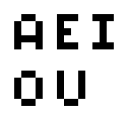
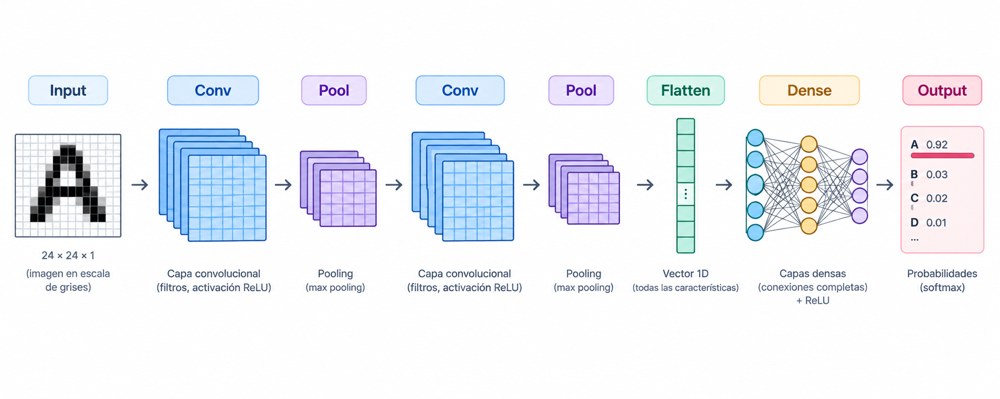
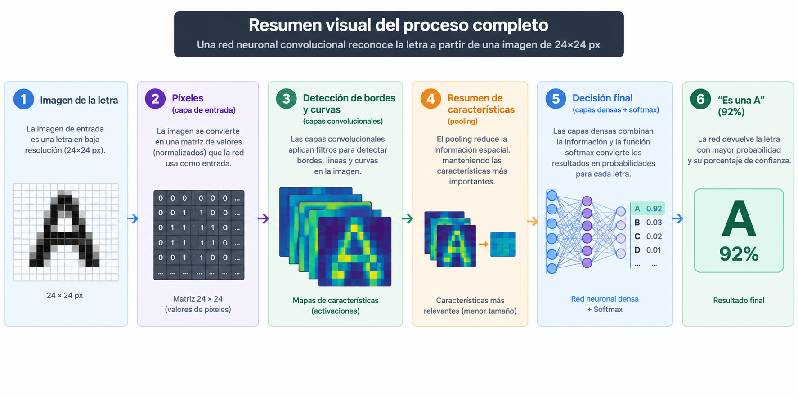

# Como piensa una Inteligencia Artificial

## 1. Introduccion
Imagina que le muestras a una inteligencia artificial una imagen de las vocales **“A E I O U”**. ¿Cómo hace para decirte cual es cada vocal?

No “ve” como nosotros. Lo que hace es transformar la imagen en números y pasarlos por una serie de capas que van detectando patrones cada vez más complejos: primero líneas, luego curvas, y al final la letra completa.

Hoy vamos a desglosar las partes de una **red neuronal** y cómo cada una contribuye a reconocer letras.

## 2. Las partes principales de una red neuronal

Una red neuronal se compone de varias capas. Cada una tiene un trabajo específico.

#### 2.1. Capa de entrada (Input Layer)
Es la primera puerta. Aquí entra la imagen convertida en números.

Cada píxel de la imagen se convierte en un valor (normalmente entre 0 y 1).  
Si la imagen es de 28×28 píxeles, tienes 784 números que entran a la red.

#### 2.2. Capas ocultas (Hidden Layers)
Aquí es donde ocurre la magia. Hay dos tipos principales cuando hablamos de imágenes:

- **a) Capas convolucionales (Convolutional Layers)**  
Son las más importantes para reconocer letras/imágenes.  
Usan filtros (pequeñas matrices) que se deslizan por la imagen buscando patrones simples: bordes verticales, horizontales, curvas, esquinas, etc.

- **b) Capas de pooling (Pooling Layers)**  
Reducen el tamaño de la información (hacen un “resumen”) para que la red sea más rápida y no se confunda con detalles irrelevantes.

- **c) Capas totalmente conectadas (Fully Connected / Dense Layers)**  
Al final, toda la información se aplana y se conecta a neuronas que empiezan a decidir “esto parece una A, una E, una O…”.

#### 2.3. Función de activación
Cada neurona aplica una función matemática (la más usada hoy es **ReLU**) que decide si se “enciende” o no.

Sin activaciones, la red solo podría hacer cálculos lineales y no podría aprender formas complejas.

#### 2.4. Capa de salida (Output Layer)
La última capa.  
Si queremos reconocer las 26 letras del abecedario, esta capa tiene 26 neuronas.  
Cada una da una probabilidad (usando Softmax).

Ejemplo de salida:
- A: 92%
- E: 3%
- I: 1%
- O: 5%
- U: 0.2%

La red elige la letra con mayor probabilidad.

## 3. Resumen visual del proceso completo

## 4. Conclusión  

Una red neuronal no “entiende” la letra como nosotros.  
Aprende a través de miles de ejemplos a detectar patrones (líneas, curvas, proporciones) y asignarles una probabilidad.

Lo impresionante es que, una vez entrenada, puede reconocer letras incluso si están torcidas, incompletas o escritas de formas muy distintas.
